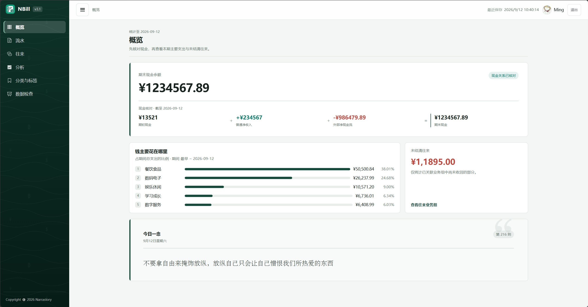
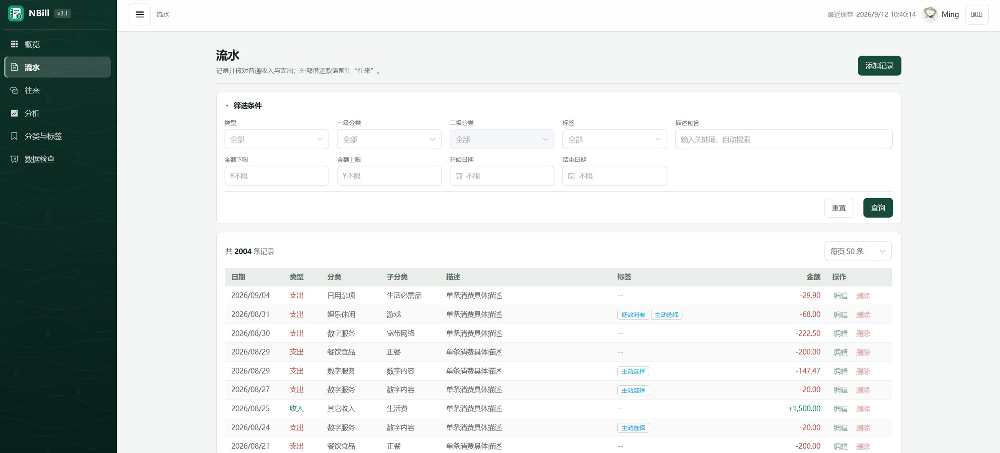
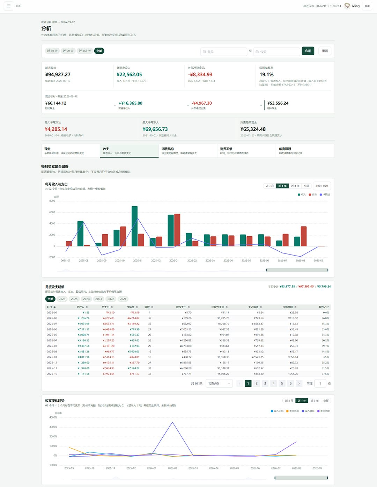

<p align="center">
  
</p>

<h1 align="center">NBill</h1>

<p align="center">
  一套面向中文用户、本地优先的私人记账程序<br>
  让日常收支、资金往来与统计分析都留在自己的电脑上
</p>

<p align="center">
  
  
  
  
  
</p>

---

NBill 将日常账单与借出、垫付、归还、报销等资金往来分开管理，并提供现金余额、月度趋势、分类分布、储蓄率和未结清往来等分析。项目由 Vue 3 前端与 Express 后端组成，适合在个人电脑上独立部署。

> NBill 是私人账本，不提供云同步和多人协作。真实配置、密码材料、账本、日志和备份默认都保存在本机，当然也可以部署在云端。

> [!NOTE]
> 本段文字由一次 PR 流程测试引入，验证 fork 之外的直接分支推送与拉取请求是否通畅。验证完成后可安全删除。

## 目录

- [界面预览](#界面预览)
- [主要功能](#主要功能)
- [统计口径](#统计口径)
- [运行环境](#运行环境)
- [快速开始](#快速开始)
- [从 CSV 创建并导入账本](#从-csv-创建并导入账本)
- [六张数据表详解](#六张数据表详解)
- [日常使用](#日常使用)
- [密码、备份与导出](#密码备份与导出)
- [开发、测试与构建](#开发测试与构建)
- [项目结构](#项目结构)
- [常见问题](#常见问题)
- [隐私与发布检查](#隐私与发布检查)

## 界面预览








## 主要功能

- 记录收入和支出，按分类、子分类与标签整理账单；
- 单独记录借出、垫付、归还、报销等外部资金往来；
- 展示现金余额、收支趋势、分类占比、储蓄率和未结清金额；
- 提供筛选、分页、编辑、删除、分类管理与标签管理；
- 支持六张 CSV 表的一次性校验与原子导入；
- 支持账本导出、本地备份和安全换密；
- 对核心账本使用 AES-256-GCM 加密，登录密码不以明文保存；
- 前后端一体构建，本地生产环境只需启动一个服务；
- 概览页按日期轮换每日格言。

## 统计口径

### 普通收支与外部往来

NBill 将两类现金流分开统计：

- **普通收支**：工资、餐饮、交通等真正形成收入或支出的事项；
- **外部往来**：借出、归还、垫付、报销等通常需要后续结清的资金流动。

外部流入不会被当作普通收入，外部流出也不会被当作普通支出，因此不会扭曲消费结构、收入结构和储蓄率。

### 现金余额

```text
期末现金余额
= 期初现金余额
+ 普通收入 - 普通支出
+ 外部流入 - 外部流出
```

`business.initialBalance` 表示**最早一笔系统流水发生之前已经持有的现金**，不是某一天的流水，也不是收入。若导入的是完整历史账本，可填写开始记账前的实际现金；若只导入某个时间点之后的数据，应填写该时间点之前的承接余额。

例如：期初现金 10,000 元，普通收入 8,000 元，普通支出 2,000 元，借出 500 元，收回 300 元，则期末现金为：

```text
10,000 + 8,000 - 2,000 - 500 + 300 = 15,800 元
```

### 往来关联

`ExternalTransactions.RelatedID` 用于把有关联的外部流水组成一组。例如“归还”记录可以关联之前的“借出”记录。它不是传统的父子字段，一条记录可以关联多个流水 ID。

## 运行环境

- Node.js 20.19 或更高版本；
- npm 9 或更高版本；
- Windows、Linux 或 macOS；
- Git，仅在克隆仓库时需要。

检查版本：

```bash
node --version
npm --version
```

## 快速开始

这里适合创建一个全新的空账本。若已经有 CSV 数据，请直接阅读[从 CSV 创建并导入账本](#从-csv-创建并导入账本)，导入时输入的密码会同时成为登录密码，无需提前执行设置密码命令。

### 1. 获取代码并安装依赖

```bash
git clone <你的仓库地址>
cd NBill
npm run setup
```

`npm run setup` 会分别安装前端和后端的锁定依赖。

### 2. 创建本地配置

Windows PowerShell：

```powershell
Copy-Item examples/config.example.json backend/config.json
```

Linux 或 macOS：

```bash
cp examples/config.example.json backend/config.json
```

生成随机登录令牌密钥：

```bash
node -e "console.log(require('node:crypto').randomBytes(32).toString('hex'))"
```

打开 `backend/config.json`，至少修改以下内容。下方只展示需要关注的片段，不要用它覆盖完整配置文件，未展示的 `storage`、`crypto`、`cors` 和 `logging` 等配置应继续保留：

```json
{
  "server": {
    "host": "127.0.0.1",
    "port": 9081
  },
  "user": {
    "username": "你的用户名"
  },
  "auth": {
    "jwtSecret": "粘贴刚才生成的随机字符串"
  },
  "business": {
    "initialBalance": 0
  }
}
```

- `host` 保持为 `127.0.0.1` 时，仅本机可以访问；
- `port` 是本地服务端口，默认值为 `9081`；
- `username` 是登录页使用的用户名；
- `jwtSecret` 必须是难以猜测的随机字符串，不要提交到 Git；
- `initialBalance` 的含义见[现金余额](#现金余额)。

其他配置项可保留样例值。完整配置说明见[部署与维护手册](docs/DEPLOY.md)。

### 3. 设置初始密码

确保服务尚未运行，然后执行：

```bash
npm run set-password
```

根据提示输入两次新密码。密码输入不会显示在终端中，这是正常现象。密码至少需要 4 个字符；建议使用更长且只用于本机账本的密码。

程序只保存由密码派生的校验材料，不保存明文密码。这个密码同时用于登录和解密账本，请妥善保管；忘记密码后无法直接找回已加密的数据。

### 4. 构建并启动

```bash
npm run build
npm start
```

浏览器访问 `http://localhost:9081`，使用配置中的用户名和刚刚设置的密码登录。空账本应先在界面中建立分类、子分类、标签、外部流水类型和往来方，再录入流水。

## 从 CSV 创建并导入账本

CSV 导入适合从电子表格或旧账本迁移数据。导入过程会先完整校验六张表；任意一行有错误时，全部数据都不会写入。已有本地账本会在替换前自动备份。

> 导入会替换当前本地数据。请先停止 NBill 服务，并确认 `backend/backups/` 中已有可用备份。不要在服务运行时执行导入。

### 1. 准备导入目录

六个文件必须放入以下固定目录，文件名和大小写必须完全一致：

```text
backend/表结构示例(测试)/
├─ Transactions.csv
├─ BillCategories.csv
├─ BillTags.csv
├─ ExternalTransactions.csv
├─ ExFlowType.csv
└─ ExRelatedParty.csv
```

Windows PowerShell：

```powershell
New-Item -ItemType Directory -Path "backend/表结构示例(测试)" -Force
```

Linux 或 macOS：

```bash
mkdir -p 'backend/表结构示例(测试)'
```

### 2. 创建 CSV 文件

可以用 Excel、WPS、LibreOffice 或纯文本编辑器创建文件。请遵守以下规则：

- 编码使用 **UTF-8（建议无 BOM）**；
- 第一行必须是本手册给出的字段名，不能翻译、增删或改变大小写；
- 使用英文逗号分隔字段；
- 包含逗号的单元格必须用英文双引号包围，双引号本身写成两个双引号；
- 单元格内不要换行；
- 日期推荐使用 `YYYY-MM-DD`，也支持 `YYYY/M/D`；
- 金额只写正数，例如 `25.50`，不要写负号、货币符号、千位分隔符或科学计数法；
- ID 必须是唯一的正整数；
- 不需要的可选字段保留为空，但逗号位置不能丢失；
- 六张表之间引用的名称和 ID 必须完全一致。

可直接复制[六张数据表详解](#六张数据表详解)中的示例，再替换为自己的数据。

### 3. 执行导入

确认已创建 `backend/config.json`，且 NBill 服务已停止，然后执行：

```bash
npm --prefix backend run import-csv
```

按提示输入导入密码。这个密码会成为新账本的登录密码和加密密码，因此从 CSV 初始化时无需先运行 `npm run set-password`。为避免密码出现在终端历史中，推荐使用交互提示，不要把密码直接写在命令后面。

导入成功后运行 `npm run build` 和 `npm start`，打开 `http://localhost:9081`。首次登录后应核对：

1. 普通流水数量、收入总额和支出总额；
2. 外部流入、外部流出与未结清金额；
3. 最早、最晚流水日期；
4. 分类、标签、往来类型和往来方是否完整；
5. 期初现金与期末现金是否符合预期。

### 4. 导入失败怎么办

导入脚本会给出文件名、行号或关联错误。修正 CSV 后重新执行即可。常见原因包括：

- 文件名或表头大小写错误；
- 金额写成 `¥1,000`、`-20` 或使用了中文逗号；
- 普通流水引用了分类表中不存在的组合；
- 标签字段包含标签表中没有的名称；
- 外部流水引用了不存在的往来类型、往来方或流水 ID；
- 同一张表中出现重复 ID；
- 日期不存在或格式无法识别。

## 六张数据表详解

### 表之间的关系

```text
BillCategories ──< Transactions >── BillTags

ExFlowType ──< ExternalTransactions >── ExRelatedParty
                       └── RelatedID → ExternalTransactions.ID
```

推荐人工准备顺序：分类、标签、外部流水类型、往来方、普通流水、外部流水。导入命令会一次读取全部文件，因此文件排列顺序不会影响结果。

### 1. BillCategories.csv：普通收支分类

固定表头：`Type,Category,Subcategory,Description`

| 字段 | 必填 | 说明 |
|---|---:|---|
| `Type` | 是 | `Income` 表示收入，`Expense` 表示支出；注意大小写 |
| `Category` | 是 | 一级分类，例如“餐饮食品” |
| `Subcategory` | 是 | 二级分类，例如“正餐” |
| `Description` | 否 | 对该分类用途的说明；留空时保存为空字符串 |

`Type + Category + Subcategory` 共同标识一个分类组合，应避免重复。

```csv
Type,Category,Subcategory,Description
Expense,餐饮食品,正餐,"食堂、饭店、快餐"
Expense,交通出行,公共交通,"公交、地铁"
Income,工作收入,工资,固定工资收入
Income,其他收入,红包,礼金或红包
```

### 2. BillTags.csv：普通流水标签

固定表头：`Tag,Description,AppliesTo`

| 字段 | 必填 | 说明 |
|---|---:|---|
| `Tag` | 是 | 唯一的标签名称 |
| `Description` | 否 | 标签用途说明；留空时保存为空字符串 |
| `AppliesTo` | 否 | `Income`、`Expense` 或 `Both`，表示收入、支出或两者均可用；留空时默认为 `Both` |

```csv
Tag,Description,AppliesTo
必要支出,维持日常生活的必要支出,Expense
主动消费,主动决定的非必要消费,Expense
固定收入,周期性稳定收入,Income
家庭,与家庭有关的收支,Both
```

### 3. Transactions.csv：普通收支流水

固定表头：`ID,Type,BillDate,Category,Subcategory,Description,Tag,Amount,Notes`

| 字段 | 必填 | 说明 |
|---|---:|---|
| `ID` | 是 | 表内唯一的正整数 |
| `Type` | 是 | `Income` 或 `Expense` |
| `BillDate` | 是 | 账单日期，推荐 `YYYY-MM-DD` |
| `Category` | 是 | 必须与分类表中的一级分类一致 |
| `Subcategory` | 是 | 必须与分类表中的二级分类一致 |
| `Description` | 是 | 流水摘要，例如“午餐” |
| `Tag` | 否 | 一个或多个已有标签；多个标签用英文逗号分隔，并用双引号包住整个字段 |
| `Amount` | 是 | 大于 0 的金额；方向由 `Type` 决定 |
| `Notes` | 否 | 补充备注，可留空 |

每条流水的 `Type + Category + Subcategory` 必须能在分类表中找到完全相同的组合；标签必须存在于标签表。

```csv
ID,Type,BillDate,Category,Subcategory,Description,Tag,Amount,Notes
1,Income,2026-01-01,工作收入,工资,一月工资,固定收入,8000,示例数据
2,Expense,2026-01-02,餐饮食品,正餐,午餐,必要支出,25.5,
3,Expense,2026-01-03,交通出行,公共交通,地铁,必要支出,4,
4,Expense,2026-01-04,餐饮食品,正餐,家庭聚餐,"必要支出,家庭",168,多人用餐
```

### 4. ExFlowType.csv：外部流水类型

固定表头：`Flowtype`

> 只有首字母 `F` 大写，不要改成 `FlowType`。

| 字段 | 必填 | 说明 |
|---|---:|---|
| `Flowtype` | 是 | 往来业务类型，例如“借出”“归还”“垫付”“报销” |

```csv
Flowtype
借出
归还
垫付
报销
```

### 5. ExRelatedParty.csv：往来方

固定表头：`Relatedparty`

> 只有首字母 `R` 大写，不要改成 `RelatedParty`。

| 字段 | 必填 | 说明 |
|---|---:|---|
| `Relatedparty` | 是 | 往来对象名称；建议使用容易辨认且不重复的名称 |

以下名称均为虚构内容：

```csv
Relatedparty
测试往来方甲
测试往来方乙
```

### 6. ExternalTransactions.csv：外部资金往来

固定表头：`ID,RelatedID,Type,FlowDate,Description,FlowType,RelatedParty,Amount`

| 字段 | 必填 | 说明 |
|---|---:|---|
| `ID` | 是 | 表内唯一的正整数 |
| `RelatedID` | 否 | 关联的外部流水 ID；多个 ID 用英文逗号分隔，并用双引号包住整个字段 |
| `Type` | 是 | `OUT` 表示现金流出，`IN` 表示现金流入 |
| `FlowDate` | 是 | 发生日期，推荐 `YYYY-MM-DD` |
| `Description` | 是 | 往来摘要 |
| `FlowType` | 是 | 必须存在于 `ExFlowType.csv` 的 `Flowtype` 列中 |
| `RelatedParty` | 是 | 必须存在于 `ExRelatedParty.csv` 的 `Relatedparty` 列中 |
| `Amount` | 是 | 大于 0 的金额；方向由 `Type` 决定 |

所有 `RelatedID` 都必须指向本表中存在的 ID。建议不要关联自身，也不要用外部往来表表达普通消费或收入。

```csv
ID,RelatedID,Type,FlowDate,Description,FlowType,RelatedParty,Amount
1,,OUT,2026-01-05,借给朋友,借出,测试往来方甲,500
2,1,IN,2026-01-20,朋友归还部分款项,归还,测试往来方甲,300
3,,OUT,2026-01-08,代买物品,垫付,测试往来方乙,120
4,3,IN,2026-01-10,收到报销,报销,测试往来方乙,120
```

ID 1 与 ID 2 所在组仍有 200 元未结清；ID 3 与 ID 4 所在组已经结清。

## 日常使用

- **普通账单**：工资、奖金记录为收入，餐饮、交通、购物记录为支出。金额始终输入正数，方向由类型决定。
- **外部往来**：借出和垫付记录为 `OUT`，归还和报销记录为 `IN`；后续流入应关联原流出。
- **数据分析**：定期核对现金余额、月度净结余、分类占比、未结清项目和数据质量提示。
- **基础资料**：分类、标签、外部流水类型和往来方采用名称关联；重命名时应通过界面完成，让后端同步更新相关流水。

## 密码、备份与导出

### 修改密码

停止 NBill 服务后执行：

```bash
npm run set-password
```

已经设置过密码时，脚本会要求输入旧密码、新密码并再次确认。换密过程会创建安全备份并重新加密受保护数据。不要手工修改密码哈希、盐值或加密文件。

### 备份

备份默认保存在 `backend/backups/`，其中含有私人账本内容且不会提交到 Git。建议定期复制到自己控制的加密磁盘或离线存储。恢复前应停止服务，并参考[部署与维护手册](docs/DEPLOY.md)。

### 导出 CSV

```bash
npm --prefix backend run export-csv -- <密码> [输出目录]
```

默认输出目录为 `backend/exported_data/`。导出文件包含明文账本，请妥善保管。密码会出现在命令行历史中，因此只应在可信的本地终端使用。

导出文件名使用小写形式：

```text
transactions.csv
bill_categories.csv
bill_tags.csv
external_transactions.csv
ex_flow_types.csv
ex_related_parties.csv
```

若要重新导入，需按导入章节将它们重命名为大小写严格匹配的六个文件名，并核对表头。

## 开发、测试与构建

开发时分别打开两个终端：

```bash
npm run dev:backend
```

```bash
npm run dev:frontend
```

默认前端开发地址为 `http://localhost:5173`，开发代理连接 `http://localhost:9081`。

验证与构建：

```bash
npm test
npm run typecheck
npm run build
npm start
```

- `npm test`：运行仓库级、后端和前端测试；
- `npm run typecheck`：检查前端 TypeScript 类型；
- `npm run build`：构建前端并发布到 `backend/public/`；
- `npm start`：由后端同时提供 API 与生产前端。

构建不会修改 `backend/data/`、`backend/backups/` 或 `backend/config.json`。

## 项目结构

```text
NBill/
├─ backend/                         Express 后端、维护脚本与本地运行目录
│  ├─ src/                          后端源码
│  ├─ tests/                        后端测试
│  ├─ data/                         私人账本与密码材料（已忽略）
│  ├─ logs/                         本地日志（已忽略）
│  ├─ backups/                      本地备份（已忽略）
│  ├─ exported_data/                明文 CSV 导出（已忽略）
│  ├─ config.json                   真实本地配置（已忽略）
│  ├─ public/                       前端构建产物（可重新生成）
│  └─ 表结构示例(测试)/             CSV 导入目录（本地使用）
├─ frontend/                        Vue 3、TypeScript 与 Vite 前端
│  └─ public/
│     ├─ icon-512.png               软件图标
│     └─ Life-Thought.json          每日格言数据
├─ docs/                            部署、接口与业务文档
│  └─ frontend-backend-manual/      面向前端开发的完整后端手册
├─ examples/                        可公开复制的配置样例
├─ tools/                           仓库级构建辅助脚本
├─ tests/repository/                仓库级脚本测试
└─ package.json                     仓库统一命令入口
```

更多资料：

- [部署与本地维护](docs/DEPLOY.md)
- [前端开发所需的后端手册](docs/frontend-backend-manual/README.md)
- [前端工程说明](frontend/README.md)

## 常见问题

### 启动后窗口立即退出

不要双击 `app.js`。请在仓库根目录打开终端并运行 `npm start`，以便看到完整错误。常见原因是依赖未安装、`backend/config.json` 不存在、9081 端口已被占用，或尚未设置密码。

### 如何检查 9081 端口

Windows PowerShell：

```powershell
Get-NetTCPConnection -LocalPort 9081 -ErrorAction SilentlyContinue
```

Linux 或 macOS：

```bash
lsof -i :9081
```

### 登录提示用户名或密码错误

用户名来自 `backend/config.json` 的 `user.username`，密码来自设置密码脚本或最近一次 CSV 导入。注意大小写和输入法；修改用户名后应重启服务。

### 页面能打开但没有数据

新账本本来就是空的。可以在界面中逐项建立基础资料与流水，也可以准备六张 CSV 表后一次导入。若刚导入过数据，请确认启动的是同一份仓库和同一个配置文件。

### 期末现金余额看起来不对

先检查 `business.initialBalance`，再核对普通收入、普通支出、外部流入和外部流出。期初现金不是一笔收入，也不要求系统中存在更早日期的流水。

### 可以直接编辑 data 目录吗

不建议。部分核心文件经过加密并带有完整性校验，手工编辑可能导致无法解密或统计错误。请使用界面和受支持的导入、导出、换密流程。

### 可以开放给局域网吗

技术上可以修改监听地址，但 NBill 定位为本地私人账本。除非明确了解网络访问控制、防火墙和终端安全，否则建议保持 `127.0.0.1`，不要直接暴露到互联网。

## 隐私与发布检查

提交或发布前至少执行：

```bash
git status --short
git diff --cached
```

确认没有加入 `backend/config.json`、`backend/data/`、`backend/logs/`、`backend/backups/`、`backend/exported_data/`、CSV 导入文件、环境变量文件、访问令牌、真实账号、真实金额或含个人信息的截图。

若敏感文件曾经进入 Git 历史，仅添加 `.gitignore` 无法删除历史副本，应在发布前重写历史，并更换所有暴露的密码和密钥。

## 许可证

本项目使用 [ISC License](LICENSE)。

`Copyright © 2026 Narrastory`
